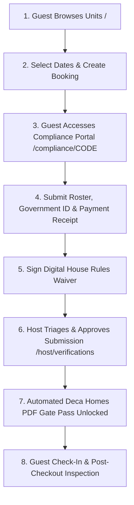

# DirectStay - Step-by-Step Setup & Run Guide

This document provides a complete, step-by-step walkthrough to install, configure, migrate, seed, and run the **DirectStay** condominium rental aggregation and compliance platform on your local machine.

---

## 1. System Requirements & Prerequisites

Before you start, ensure you have the following installed on your machine:

| Tool | Minimum Version | Notes |
| :--- | :--- | :--- |
| **PHP** | `^8.3` | Required extensions: `pdo_sqlite` (or `pdo_mysql`), `fileinfo`, `gd`, `mbstring`, `openssl`, `curl` |
| **Composer** | `2.x` | PHP dependency manager |
| **Node.js & npm** | `Node 18+` or `20+` / `npm 10+` | Required for Tailwind CSS v4 and Vite bundling |
| **Laragon / Web Server** | *(Optional)* | Pre-configured PHP 8.3+, MySQL, and automatic virtual hosts (`http://directstay.test`) |

### Verify Prerequisites

Open your terminal (PowerShell, Command Prompt, or Bash) and run:

```bash
php -v
composer -V
node -v
npm -v
```

---

## 2. Step-by-Step Installation

### Step 1: Open Terminal in Project Directory
Navigate to the project root:

```bash
cd C:\laragon\www\DirectStay
```

---

### Step 2: Install PHP Dependencies
Run Composer to install all backend packages:

```bash
composer install
```

---

### Step 3: Configure Environment File (`.env`)
If `.env` does not exist yet, duplicate `.env.example`:

**Windows PowerShell:**
```powershell
Copy-Item .env.example .env
```

**Linux / macOS / Git Bash:**
```bash
cp .env.example .env
```

#### Generate Application Encryption Key
```bash
php artisan key:generate
```

#### Database Configuration
By default, DirectStay is configured to use **SQLite** for zero-configuration local execution.

* **SQLite (Default):**
  Ensure the SQLite database file exists:
  ```powershell
  # Windows PowerShell
  if (!(Test-Path "database\database.sqlite")) { New-Item -ItemType File -Path "database\database.sqlite" -Force }
  ```
  ```bash
  # Linux / macOS / Git Bash
  touch database/database.sqlite
  ```

  In your `.env` file, verify:
  ```dotenv
  DB_CONNECTION=sqlite
  ```

* **MySQL (Optional via Laragon / XAMPP):**
  If you prefer MySQL:
  1. Start MySQL in Laragon / your database service.
  2. Create a database named `directstay`.
  3. Update `.env`:
     ```dotenv
     DB_CONNECTION=mysql
     DB_HOST=127.0.0.1
     DB_PORT=3306
     DB_DATABASE=directstay
     DB_USERNAME=root
     DB_PASSWORD=
     ```

---

### Step 4: Run Database Migrations & Seeders
DirectStay includes a seeder with initial buildings (Urban Deca Homes Ortigas Buildings N & P), units (Pad Dos N343 & Pad Uno P718), house rules, inventory checklists, add-ons, and pre-configured Host and Guest test accounts.

Run migrations and seed the database:

```bash
php artisan migrate --seed
```

> **Tip:** If you ever want a fresh, clean database reset with seed data, run:
> ```bash
> php artisan migrate:fresh --seed
> ```

---

### Step 5: Link Storage for Uploaded Documents & Photos
DirectStay handles guest identity verification documents, payment deposit slips, and unit gallery images. Create the symbolic link between `storage/app/public` and `public/storage`:

```bash
php artisan storage:link
```

> **Note on Data Privacy (RA 10173):** Government IDs and sensitive guest compliance documents are securely stored in the private disk (`storage/app/private`) and streamed through authenticated controllers rather than exposed directly on public paths.

---

### Step 6: Install Frontend Dependencies & Build Assets
Install Node modules and compile the Tailwind CSS v4 + Alpine.js assets using Vite:

```bash
npm install
npm run build
```

> **Troubleshooting on Windows PowerShell:**
> If you encounter `npm.ps1 cannot be loaded because running scripts is disabled on this system`, use `npm.cmd` instead:
> ```powershell
> npm.cmd install
> npm.cmd run build
> ```
> Or temporarily allow script execution in your PowerShell session:
> ```powershell
> Set-ExecutionPolicy -Scope Process -ExecutionPolicy Bypass
> ```

---

## 3. How to Run the Application

You can run DirectStay using any of the following methods depending on your workflow:

### Option A: All-in-One Dev Command (Recommended)
Laravel provides a unified dev command that starts both the backend HTTP server and the Vite asset server concurrently:

```bash
composer run dev
```
Open your browser at: **[http://localhost:8000](http://localhost:8000)**

---

### Option B: Separate Terminals (Standard Development)

1. **Terminal 1 - Laravel Backend Server:**
   ```bash
   php artisan serve
   ```
   *Serves application at `http://localhost:8000` (or `http://127.0.0.1:8000`).*

2. **Terminal 2 - Vite Frontend Hot-Reload:**
   ```bash
   npm run dev
   # Or on Windows PowerShell:
   npm.cmd run dev
   ```
   *Provides live hot-module replacement for stylesheets, Blade layouts, and Alpine.js components.*

---

### Option C: Laragon Virtual Host (Windows)
If you are using **Laragon**:
1. Open the Laragon dashboard and click **Start All** (Apache & MySQL).
2. Laragon automatically binds the project folder to: **[http://directstay.test](http://directstay.test)**
3. In your terminal, run `npm run dev` (or `npm run build`) for assets.

---

## 4. Pre-Configured Test Accounts & Credentials

The database seeder (`DirectStaySeeder`) provides accounts ready for testing all guest and host capabilities:

### 1. Host / Property Lessor Portal
* **Login URL:** [http://localhost:8000/host/login](http://localhost:8000/host/login) (or `/host`)
* **Email:** `host@directstay.local`
* **Password:** `password`
* **Assigned Role:** `host` (Ferlyn Miranda & Aurelio J. Budol Sr. / A-F Staycation)
* **Features to Explore:**
  * **Host Dashboard:** View active reservations, occupancy metrics, and incoming guest requests.
  * **Unit Management (`/host/units`):** Manage Units N343 & P718, adjust base night rates, edit inventory, and upload high-resolution gallery photos.
  * **Manual Calendar Blocking (`/host`):** Block individual dates or date ranges across specific units.
  * **Verification Triage (`/host/verifications`):** Review guest-uploaded government IDs, proof-of-payment bank receipts, and approve/reject bookings.
  * **Post-Checkout Inventory & Penalty Engine (`/host/checkouts/{booking}`):** Interactive unit inspection checklist that automatically calculates security deposit refund deductions for damaged or missing items.

---

### 2. Guest / Customer Account
* **Login URL:** [http://localhost:8000/login](http://localhost:8000/login)
* **Email:** `customer@directstay.local`
* **Password:** `password`
* **Assigned Role:** `guest` (Kenry M. Cui)
* **Features to Explore:**
  * **Direct Booking Catalog (`/`):** View units, live price comparison against nearby Ortigas condos, select check-in/out dates, and select optional add-ons.
  * **Customer Bookings (`/my-bookings`):** Access confirmed reservations, booking codes, and direct compliance links.
  * **Account Settings (`/account/settings`):** Update personal details, contact phone, and change passwords.

---

### 3. Registering a New Customer Account
* **Register URL:** [http://localhost:8000/register](http://localhost:8000/register)
* **Email OTP Verification:**
  * During local testing with `MAIL_MAILER=log`, activation emails and 6-digit verification codes are written directly to your log file:
  * Open `storage/logs/laravel.log` and search for `Your verification code is: XXXXXX` to complete email verification.

---

## 5. Key Workflows to Test End-to-End



1. **Direct Booking Flow:**
   * Go to `/` and pick **Unit N343 (Pad Dos)** or **Unit P718 (Pad Uno)**.
   * Review comparative competitor pricing (Urban Deca vs. Sorrento Oasis, East Raya Gardens, etc.).
   * Click **Book Unit Now**, select dates, add extra guests or pool passes, and submit the booking.

2. **Guest Digital Compliance Portal:**
   * You will be redirected to `/compliance/{bookingCode}`.
   * Step 1: Complete the guest roster names and ages.
   * Step 2: Upload a sample Government ID photo.
   * Step 3: Upload a sample GCash / Bank transfer proof of deposit.
   * Step 4: Accept and sign the building house rules waiver.

3. **Host Verification & Gate Pass Generation:**
   * Log in to the Host portal at `/host/login`.
   * Navigate to **Verifications** (`/host/verifications`) and click on the new booking.
   * Inspect the streamed documents and click **Approve Booking**.
   * Back on the compliance portal, download the official **Building N / P Lobby Gate Pass PDF** and **Rental Agreement PDF** generated via DomPDF.

4. **Post-Checkout Digital Inspection:**
   * In the Host portal, go to `/host/checkouts/{bookingCode}`.
   * Conduct the digital room turnover inspection, check off appliances, mark any damaged items, and submit the penalty assessment.

---

## 6. Helpful Maintenance & Troubleshooting Commands

| Command | Purpose |
| :--- | :--- |
| `php artisan optimize:clear` | Clear all config, route, view, and application caches |
| `php artisan migrate:fresh --seed` | Wipe database and re-seed all initial units, accounts, and rules |
| `php artisan route:list` | Inspect all registered application routes |
| `php artisan storage:link` | Recreate the public storage symlink |
| `npm run build` | Recompile production CSS/JS assets if styling updates do not appear |
| `Get-Content storage\logs\laravel.log -Wait -Tail 30` | Stream real-time Laravel log entries (PowerShell) |

---

## 7. Need Help?

* Check application logs anytime at: `storage/logs/laravel.log`.
* Verify database connection settings in `.env`.
* If you have frontend styles missing, ensure `npm run build` has completed without errors.

